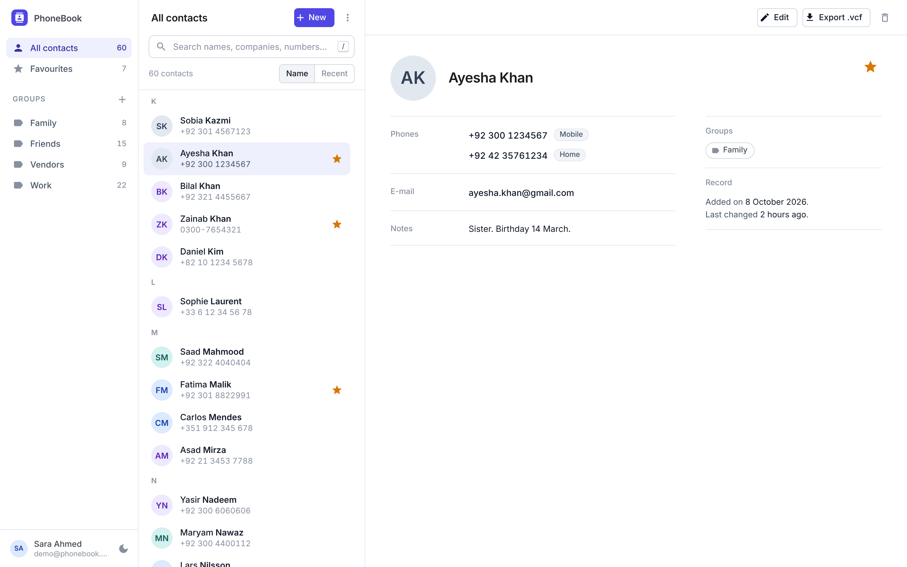
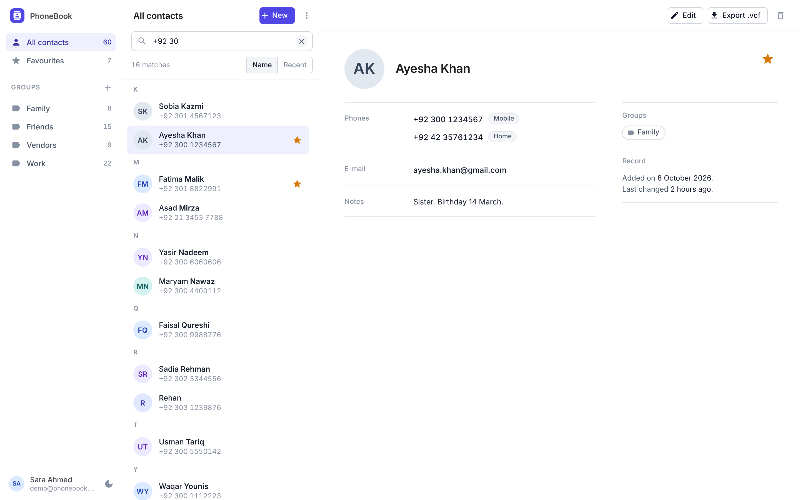
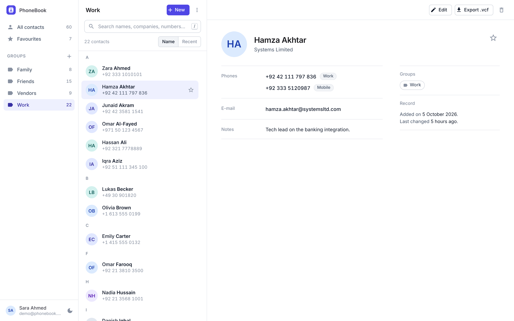
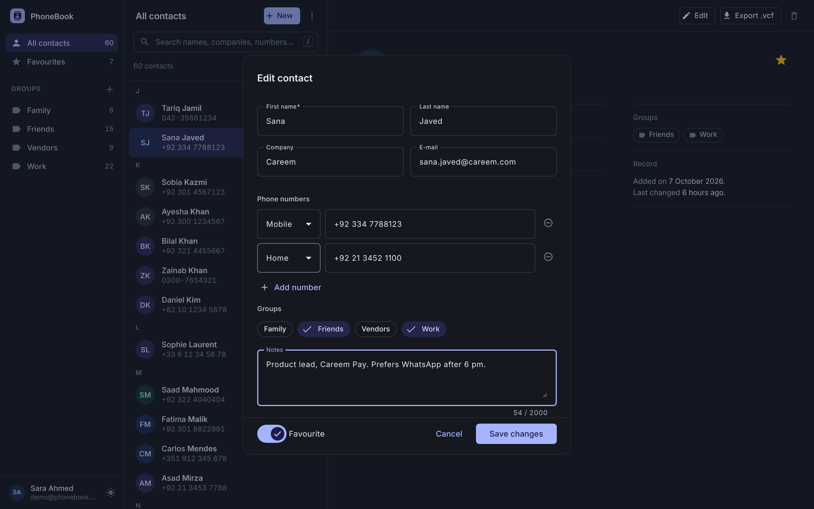
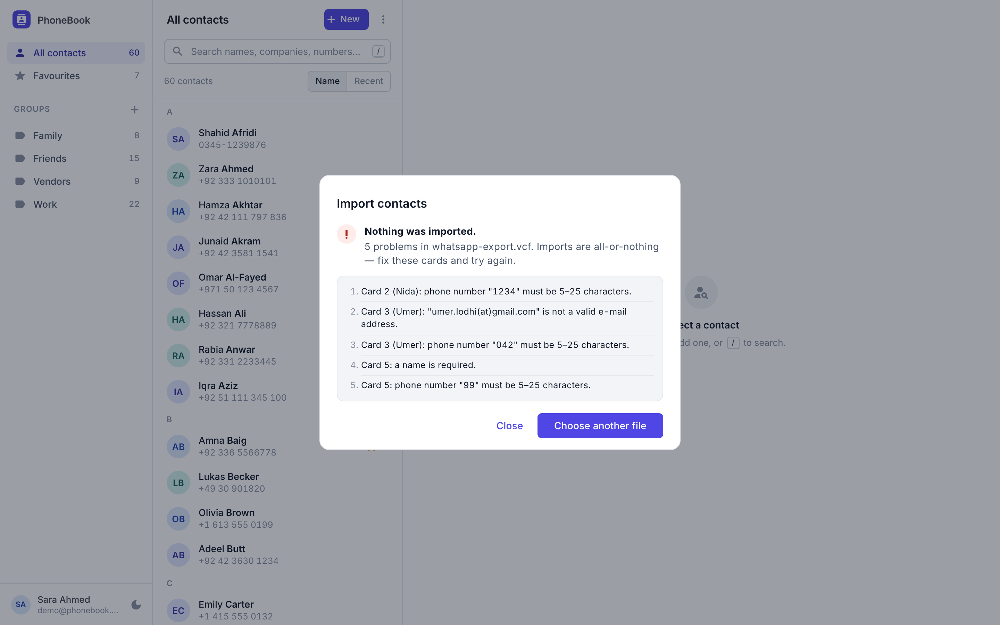
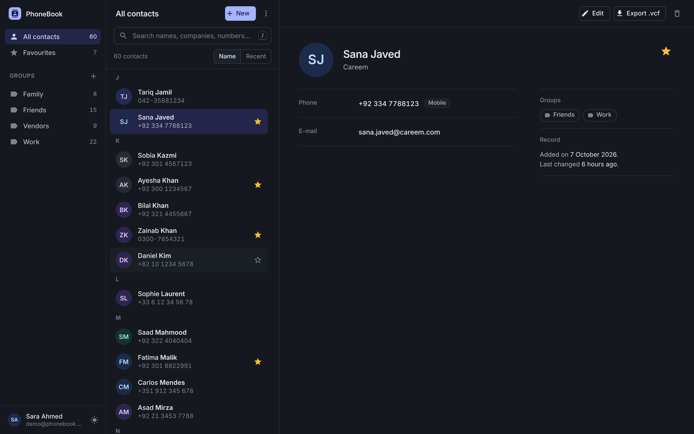
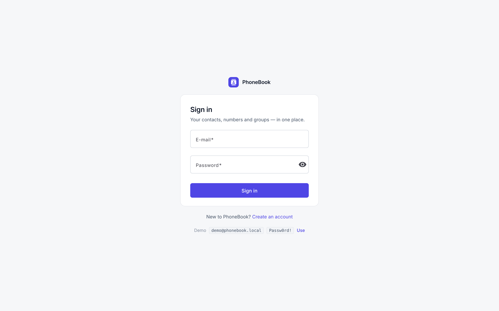
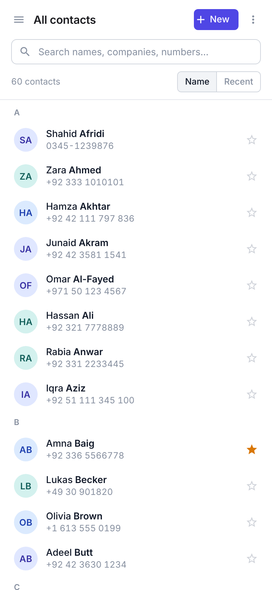

# PhoneBook

[](https://github.com/gn-4200/PhoneBook/actions/workflows/ci.yml)


**PhoneBook** is a personal contacts manager: sign in, keep your people with several phone numbers each, sort them into groups, star favourites, search by name or by any part of a number, and move everything in and out as standard **vCard** files. Every account sees only its own data.

<p align="center">
  
</p>

<details>
<summary><strong>More screens</strong> — search by digits, editor, import errors, dark mode, mobile</summary>
<br>

| Search matches any part of a number | Group filter |
|---|---|
|  |  |

| Contact editor (dark) | Import rejected — per-card errors, nothing imported |
|---|---|
|  |  |

| Dark mode | Sign in |
|---|---|
|  |  |

| Mobile — list | Mobile — detail |
|---|---|
|  |  |

</details>

## Repository layout

```
PhoneBook/
├── src/client/        Angular 19 + Material 3 web app
├── src/server/        ASP.NET Core 9 Web API, EF Core, JWT
├── src/server.Tests/  xUnit: unit tests + integration tests (WebApplicationFactory)
├── src/PhoneBook.sln
├── API-CONTRACT.md    the HTTP contract both halves are built against
├── docker-compose.yml API + web, one command
└── .github/workflows  CI: API build & tests · web tests & build · Docker images
```

## What it does

- **Contacts** — first and last name, company, e-mail, notes and one or more phone numbers (Mobile / Home / Work / Other). Create, edit, delete.
- **Search** — one box matches first/last name, company, e-mail and any phone number, ignoring punctuation: typing `0300 123` finds `0300-123-4567`.
- **Groups** — create and rename groups, put a contact in several, filter the list by group. Deleting a group never deletes its contacts.
- **Favourites** — star a contact and filter to starred ones. Sort by name or by most recently updated; results are paged.
- **vCard import / export** — export everything, one group, selected ids, or a single contact as `.vcf` (vCard 3.0); import a `.vcf` and get back how many cards were imported and skipped.
- **Accounts** — register and sign in; a JWT (8 h) guards every call, and each user only ever sees their own contacts and groups.
- **Errors** — validation failures come back as RFC 7807 `ValidationProblemDetails` with per-field messages.

The Angular client is a master-detail layout: a searchable, filterable contact list on one side and the selected contact's detail pane on the other, with group and favourite filters, and import/export actions for the vCard endpoints.

## Architecture

```
 Browser ──► nginx (web image) ──► /api/* ──► ASP.NET Core 9 API ──► SQLite  (or SQL Server)
             static Angular bundle             Controllers → Services → IUnitOfWork → Repositories
                                               hand-rolled JWT · Swagger (Development) · /health
```

| Layer | Folder (`src/server/`) | Responsibility |
|---|---|---|
| Controllers | `Api/` | HTTP only: binding, status codes, `[Authorize]`, error mapping |
| Services | `Application/` | Business rules, DTOs, vCard parsing/writing, token issuing |
| Domain | `Domain/` | Entities: user, contact, phone number, group |
| Infrastructure | `Infrastructure/` | `DbContext`, provider switch, generic repository, unit of work |

- In production the client and API share an origin (`/api` is proxied by nginx), so there is no CORS to configure.
- In development the Angular dev server runs on `:4300` and talks to the API on `:5180`; CORS allows that origin (`Cors:AllowedOrigins`).

## API

Base URL in development: `http://localhost:5180/api`. Everything except `/auth/*` and `/health` needs `Authorization: Bearer <token>`. The full contract, with payload shapes, is in [`API-CONTRACT.md`](API-CONTRACT.md); run the API in Development and open the root URL for Swagger UI.

| Method | Route | Purpose |
|---|---|---|
| POST | `/auth/register` | Create an account (password ≥ 8 chars), returns a token; 409 if the e-mail exists |
| POST | `/auth/login` | Returns a token; 401 on bad credentials |
| GET | `/auth/me` | Signed-in user's `{ id, name, email }` |
| GET | `/contacts?q&groupId&favourites&page&pageSize&sort` | Paged, searchable list (`sort=name\|recent`) |
| POST | `/contacts` | Create a contact (≥ 1 phone), 201 |
| GET / PUT / DELETE | `/contacts/{id}` | Read / replace / remove one contact |
| PUT | `/contacts/{id}/favourite` | `{ isFavourite }` |
| GET | `/contacts/export?groupId&ids` | vCard 3.0 file `contacts.vcf` |
| GET | `/contacts/{id}/vcard` | One contact as `firstname-lastname.vcf` |
| POST | `/contacts/import` | Multipart field `file` (`.vcf`); all-or-nothing |
| GET / POST | `/groups` | List with contact counts / create (409 on duplicate name) |
| PUT / DELETE | `/groups/{id}` | Rename / delete (contacts stay) |
| GET | `/health` | Liveness + database check |

## Run it

### Option A — Docker

```bash
cp .env.example .env            # set a 32+ char JWT_SECRET
docker compose up --build
```

| | URL |
|---|---|
| Web app | http://localhost:4300 |
| API | http://localhost:5180 (`/health`) |

The SQLite file lives in the `phonebook-data` volume, so contacts survive restarts.

### Option B — local SDKs

Requirements: .NET 9 SDK and Node 22.

```bash
# API — http://localhost:5180
cd src/server
dotnet user-secrets set "Jwt:Secret" "$(openssl rand -base64 48)"
dotnet run

# Web — http://localhost:4300 (second terminal)
cd src/client && npm ci && npm start
```

The SQLite database (`phonebook.db`) is created on first run. To use SQL Server instead, set `Database:Provider` to `SqlServer` and provide `ConnectionStrings:DefaultConnection`.

### Configuration

| Key | Required | Notes |
|---|---|---|
| `Jwt:Secret` | yes | ≥ 32 chars — the app refuses to start otherwise (`appsettings.Development.json` carries a dev-only value) |
| `Jwt:Issuer`, `Jwt:Audience`, `Jwt:ExpiryHours` | no | Defaults `PhoneBook.Api`, `PhoneBook.Client`, `8` |
| `Database:Provider` | no | `Sqlite` (default) or `SqlServer` |
| `ConnectionStrings:DefaultConnection` | SQL Server only | Defaults to `Data Source=phonebook.db`; `/app/data/phonebook.db` in the image |
| `Cors:AllowedOrigins` | no | Array; defaults to `http://localhost:4300` |

Environment variables use `__` as the separator (`Jwt__Secret`, `Cors__AllowedOrigins__0`).

## Tests

```bash
dotnet test src/PhoneBook.sln        # 35 tests: 8 vCard unit, 5 Unit-of-Work unit, 22 integration
cd src/client && npm test            # Karma/Jasmine, headless Chrome
```

The integration tests boot the real API with `WebApplicationFactory` on an in-memory SQLite database (`Database:Provider=Sqlite`). They cover registration and login, token claims, 401s, validation problems, contact CRUD, per-user isolation, phone-digit search, favourites, groups, sorting and paging, vCard export, and import including the rollback case. The unit tests pin down the Unit of Work (staging, commit, rollback) and the vCard reader/writer. Both suites run on every push ([CI](.github/workflows/ci.yml)), followed by a Docker build of both images.

## Engineering highlights

**Generic Repository + Unit of Work** is the backbone of the server. A repository only *stages* changes; it never saves:

```csharp
// IRepository<T> — a thin wrapper over a DbSet, no SaveChanges anywhere
void Add(T entity);
void Remove(T entity);
IQueryable<T> Query();

// IUnitOfWork — typed repositories over ONE DbContext, and the only way to persist
IRepository<Contact> Contacts { get; }
Task<int> SaveChangesAsync(CancellationToken ct = default);
Task BeginTransactionAsync(CancellationToken ct = default);
Task CommitAsync(CancellationToken ct = default);
Task RollbackAsync(CancellationToken ct = default);
```

Services depend on `IUnitOfWork` alone and never see the `DbContext`, so one business operation touches several repositories and commits them together, or not at all. The vCard import is the showcase: it stages contacts in batches of 50 (`SaveChangesAsync` per batch) inside one explicit transaction, keeps validating to report every bad card at once, and rolls back on the first invalid one, so an import is all-or-nothing, whether the file holds three cards or several hundred.

- **Hand-rolled JWT auth** — no ASP.NET Identity: `PasswordHasher<User>` for credentials, a signed HS256 token with `sub`/`name`/`email` claims, issuer/audience/lifetime validation, and a startup check that refuses a missing or short secret.
- **Per-user data isolation** — every query is scoped to the caller. Another user's contact or group is a `404`, never a `403`, so ids do not leak; a contact cannot be put into someone else's group.
- **Dependency-free vCard 3.0** — a small reader/writer that handles folded lines, escaped commas/semicolons/newlines, `TEL;TYPE=` mapping and group prefixes, and skips garbage between cards. No library.
- **Contract-first errors** — data annotations on inputs, RFC 7807 `ValidationProblemDetails` / `ProblemDetails` for every failure path via one exception handler.
- **Designed to be tested** — the database provider is a config switch (`Sqlite` / `SqlServer`), so the real app boots on in-memory SQLite inside `WebApplicationFactory`; the tests exercise HTTP, auth and validation end to end.
- **Operational hygiene** — secrets via user-secrets or environment only, health endpoint, non-root container, Docker Compose, CI on every push.

## Roadmap

- [x] JWT accounts with per-user data
- [x] Groups, favourites, digit-insensitive search
- [x] vCard import and export, transactional
- [x] One-command Docker stack
- [ ] Contact photos
- [ ] Deploy a demo with seeded data
- [ ] E2E smoke tests with Playwright

## License

MIT © Ghulam Nabi
